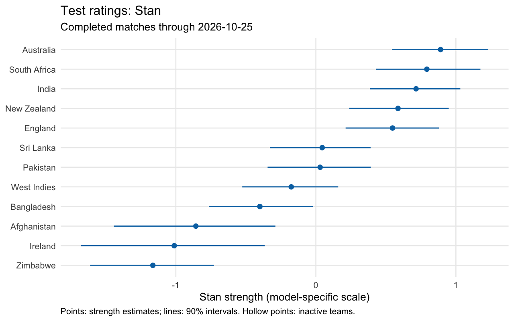
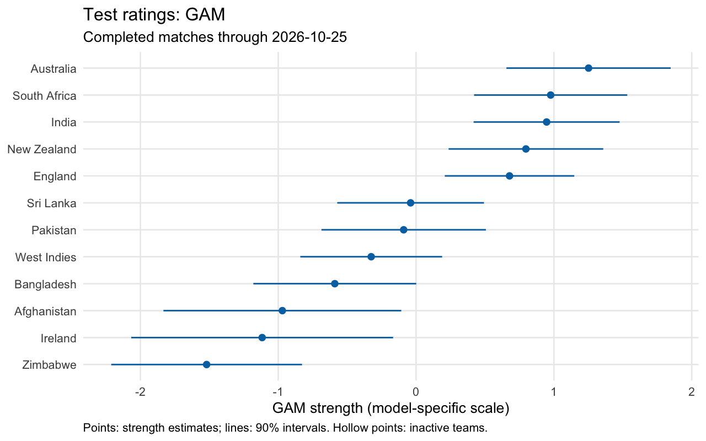
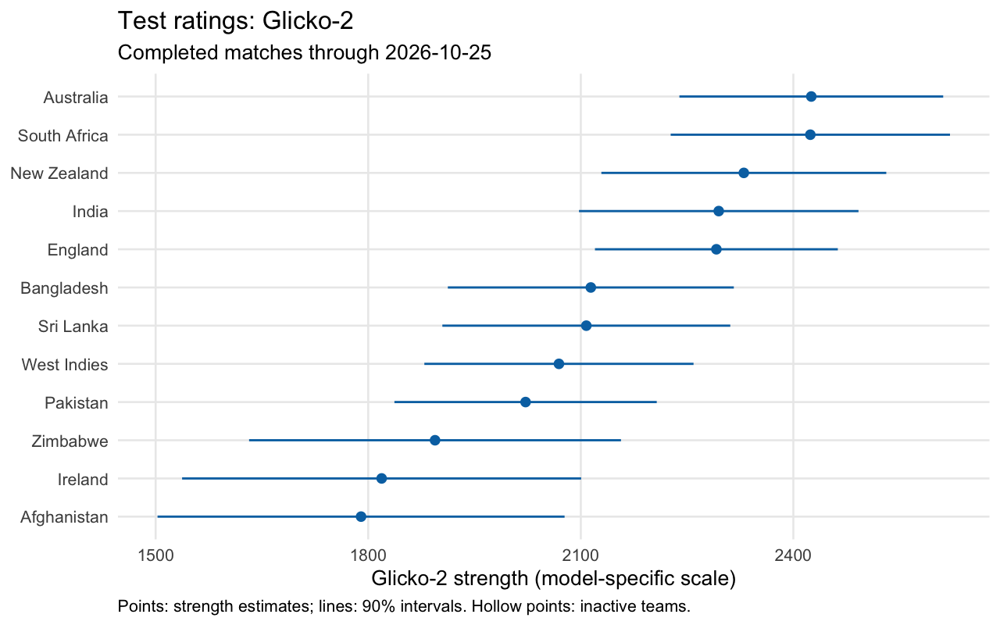
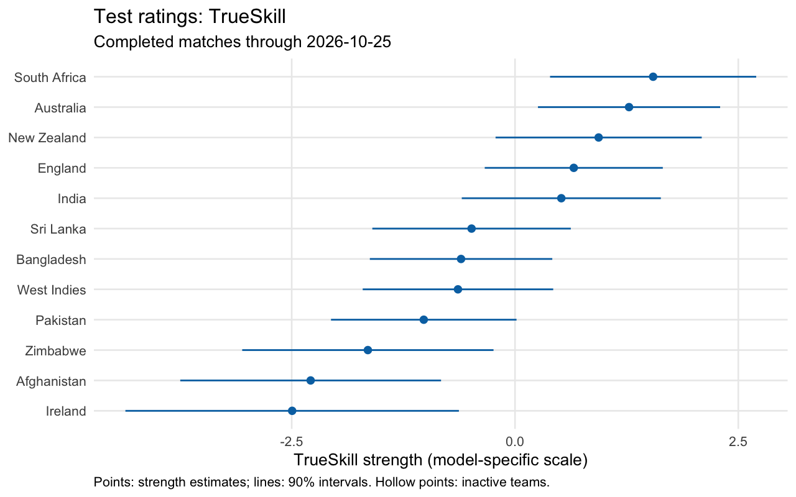

```{r}
#| include: false
source("R/site.R")
publication <- read_current_publication("out/release/models/test")
elo <- read_publication("out/release/elo")
```

**Results through `r publication$manifest$as_of`.** These ratings use
`r length(publication$manifest$train_ids)` completed Tests from 2000 onward.
Stan, GAM, Glicko-2, and TrueSkill each estimate national-team strength under
different assumptions. Each has its own scale: compare teams within a model.

```{r}
#| results: asis
if (publication$manifest$as_of != elo$manifest$analysis$as_of) {
  cat("::: {.callout-warning}\nThese model ratings have an older or different cutoff than Elo (",
      elo$manifest$analysis$as_of, "). Check the dates before comparing them.\n:::\n", sep = "")
}
```

The weekly update fits these methods to all eligible completed matches through
its cutoff. [Historical forecast evaluation](research.qmd) is separate.
These methods remain experimental; their availability is not evidence that one
predicts better than the others. [Elo ratings](test.qmd) use a longer history.

[Download all current ratings](../out/release/models/test/latest.csv) ·
[Fit metadata](../out/release/models/test/manifest.json) ·
[Methods and reproduction](https://github.com/outside-edge/elo_cricket/blob/main/docs/current_models.md)

## Stan

The dynamic probit model allows strength to change quarterly and models
home advantage and draws using country and ground context. Estimates are posterior
means with 90% credible intervals. The current quarter's estimate uses completed
matches through the cutoff, including matches later than the quarter's start.

```{r}
#| results: asis
knitr::kable(site_model_ratings(publication, "stan_dynamic_probit"), format = "html", escape = TRUE, row.names = FALSE)
```



[Sampler diagnostics](../out/release/models/test/stan_diagnostics.json)

## GAM

Penalized splines estimate smooth team trajectories, with country and ground
variation in home advantage. Current strengths use the fitted endpoint, with
approximate 90% intervals that include smoothing uncertainty.

```{r}
#| results: asis
knitr::kable(site_model_ratings(publication, "gam"), format = "html", escape = TRUE, row.names = FALSE)
```



## Glicko-2

Glicko-2 tracks ratings, rating deviations, and volatility using monthly periods.
The current month is partial. Inactive teams retain their estimates but gain
uncertainty over empty periods. Displayed intervals are approximate normal 90%
intervals based on the rating deviation. This model has no venue adjustment.

```{r}
#| results: asis
knitr::kable(site_model_ratings(publication, "glicko2"), format = "html", escape = TRUE, row.names = FALSE)
```



## TrueSkill

TrueSkill updates Gaussian skill estimates as results arrive. We use forward
filtering from the R package `TrueSkillThroughTime`, without its backward
smoothing step. Calendar days govern uncertainty growth; draws and ties share a
draw outcome. Displayed intervals are approximate Gaussian 90% intervals. This
is a team model without venue effects, distinct from the contextual Stan model.

```{r}
#| results: asis
knitr::kable(site_model_ratings(publication, "trueskill"), format = "html", escape = TRUE, row.names = FALSE)
```



## Reading the tables

Ranks order point estimates among teams with a rated match in the preceding
730 days. Fewer than ten matches is provisional. Intervals describe strength
uncertainty under each model, not uncertainty about a match result or a team's
rank. A numerical rank difference can coexist with substantial uncertainty.

[Download GAM and Stan histories](../out/release/models/test/strengths.csv).
These histories use the full fitted sample and are retrospective estimates,
not archived forecasts. Current ratings and the older evaluation have separate
cutoffs and files.
