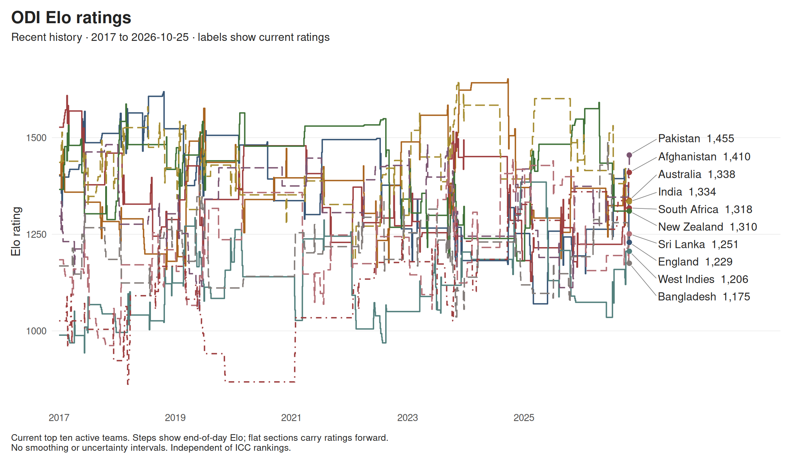
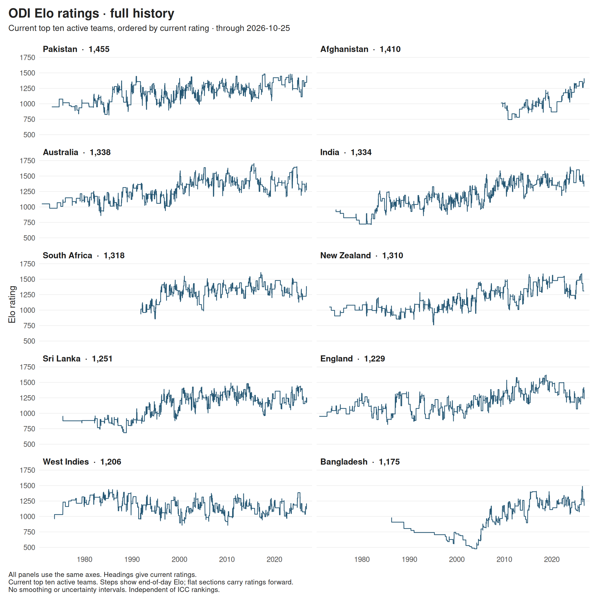
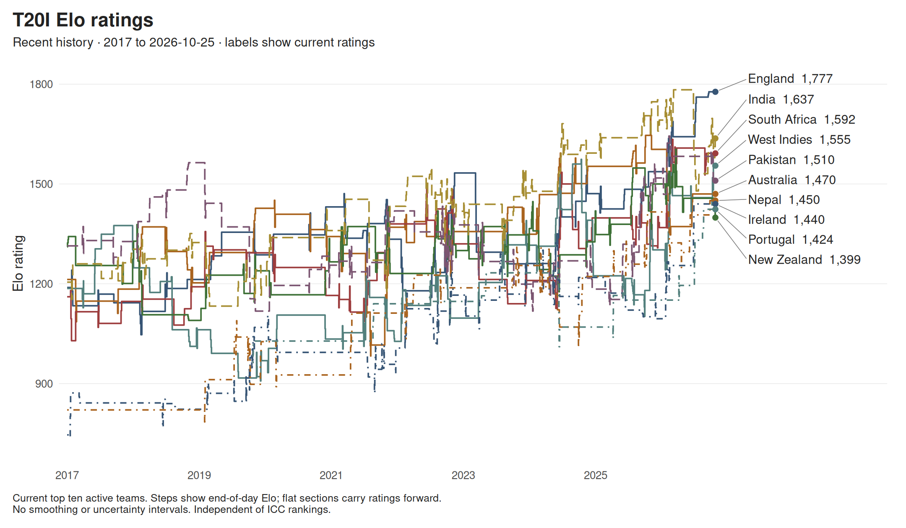
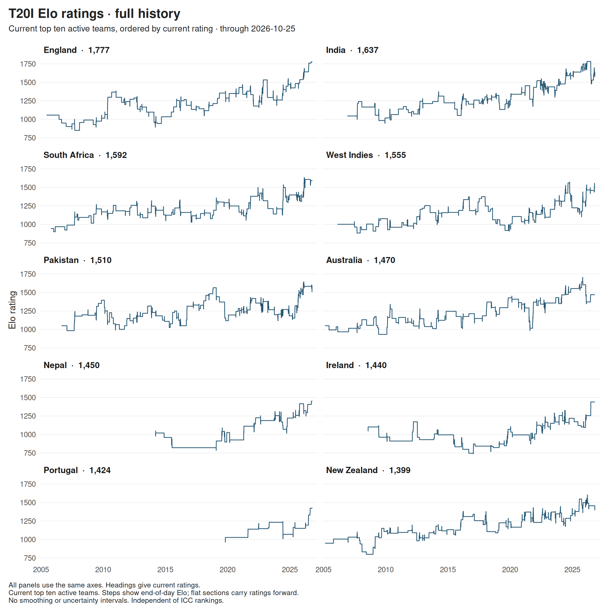
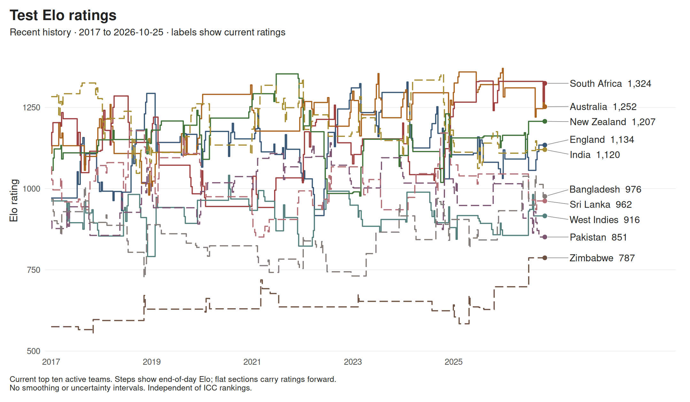
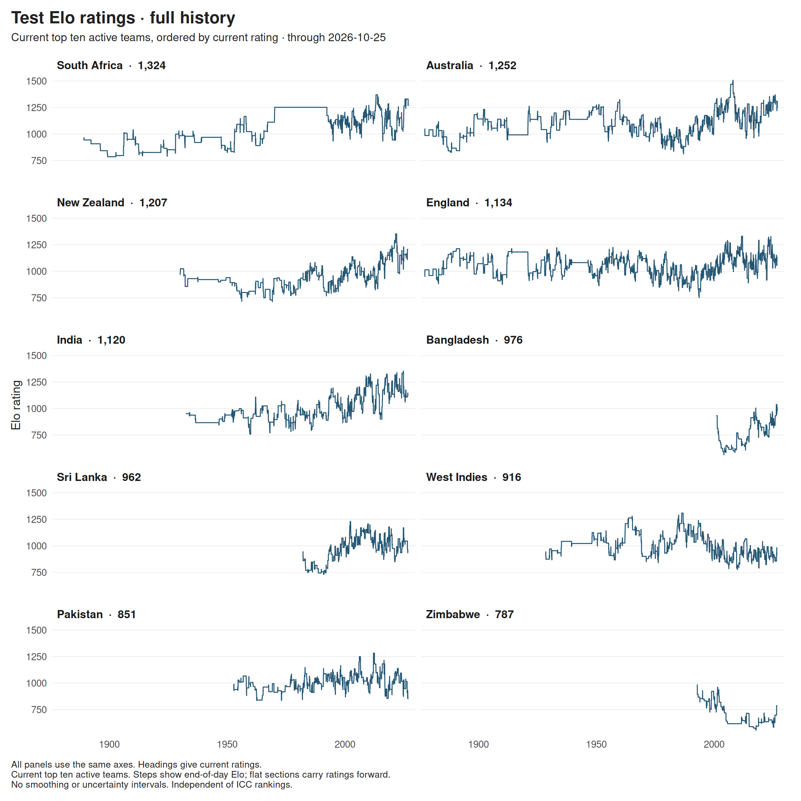

# ELO cricket ratings through 2026-10-25

Independent ratings of men's international teams. Results enter on their completion date.

[Latest ratings](latest.csv) · [Monthly history](monthly.csv) · [Match updates](updates.csv)

[Methods and limitations](../../../README.md#elo-specification)

## ODI

Most recent recorded result: 2026-10-25

[Download recent-history SVG](odi.svg)

Full history by team

[Download full-history SVG](odi_history.svg)

### Current ratings

| Rank | Team | Rating | Rated matches | Last rated match |
| ---: | --- | ---: | ---: | --- |
| 1 | Pakistan | 1455 | 984 | 2026-10-25 |
| 2 | Afghanistan | 1410 | 185 | 2026-10-23 |
| 3 | Australia | 1338 | 996 | 2026-09-30 |
| 4 | India | 1334 | 1040 | 2026-10-03 |
| 5 | South Africa | 1318 | 683 | 2026-09-30 |
| 6 | New Zealand | 1310 | 814 | 2026-07-21 |
| 7 | Sri Lanka | 1251 | 908 | 2026-10-22 |
| 8 | England | 1229 | 801 | 2026-10-25 |
| 9 | West Indies | 1206 | 875 | 2026-10-03 |
| 10 | Bangladesh | 1175 | 459 | 2026-10-21 |
| 11 | Zimbabwe | 1111 | 576 | 2026-10-23 |
| 12 | Scotland | 999 | 175 | 2026-08-13 |
| 13 | Namibia | 996 | 85 | 2026-10-24 |
| 14 | Ireland | 977 | 200 | 2026-10-24 |
| 15 | U.S.A. | 964 | 86 | 2026-10-13 |
| 16 | Netherlands | 952 | 148 | 2026-10-25 |
| 17 | Nepal | 870 | 97 | 2026-10-19 |
| 18 | Canada | 719 | 114 | 2026-10-17 |
| 19 | U.A.E. | 701 | 140 | 2026-10-25 |
| 20 | Oman | 611 | 76 | 2026-10-19 |

## T20I

Most recent recorded result: 2026-10-25

[Download recent-history SVG](t20i.svg)

Full history by team

[Download full-history SVG](t20i_history.svg)

### Current ratings

| Rank | Team | Rating | Rated matches | Last rated match |
| ---: | --- | ---: | ---: | --- |
| 1 | England | 1777 | 222 | 2026-09-19 |
| 2 | India | 1637 | 290 | 2026-10-24 |
| 3 | South Africa | 1592 | 232 | 2026-09-06 |
| 4 | West Indies | 1555 | 247 | 2026-10-14 |
| 5 | Pakistan | 1510 | 296 | 2026-10-13 |
| 6 | Australia | 1470 | 222 | 2026-06-21 |
| 7 | Nepal | 1450 | 120 | 2026-09-25 |
| 8 | Ireland | 1440 | 181 | 2026-06-28 |
| 9 | Portugal | 1424 | 51 | 2026-08-21 |
| 10 | New Zealand | 1399 | 257 | 2026-10-24 |
| 11 | U.S.A. | 1390 | 56 | 2026-02-15 |
| 12 | Jersey | 1389 | 61 | 2026-05-23 |
| 13 | Sri Lanka | 1385 | 241 | 2026-10-13 |
| 14 | Kenya | 1356 | 135 | 2026-09-19 |
| 15 | Spain | 1353 | 53 | 2026-08-21 |
| 16 | Afghanistan | 1316 | 167 | 2026-09-25 |
| 17 | Zimbabwe | 1298 | 200 | 2026-09-06 |
| 18 | U.A.E. | 1296 | 151 | 2026-09-17 |
| 18 | Uganda | 1296 | 129 | 2026-10-25 |
| 20 | Denmark | 1276 | 52 | 2026-07-14 |
| 21 | Namibia | 1275 | 98 | 2026-09-04 |
| 22 | Nigeria | 1258 | 103 | 2026-10-25 |
| 23 | Bangladesh | 1249 | 217 | 2026-10-03 |
| 24 | Qatar | 1235 | 88 | 2026-10-14 |
| 25 | Netherlands | 1230 | 128 | 2026-02-18 |
| 26 | Hong Kong | 1221 | 137 | 2026-10-14 |
| 27 | Italy | 1220 | 42 | 2026-02-19 |
| 28 | Bermuda | 1218 | 59 | 2026-09-27 |
| 29 | Tanzania | 1217 | 80 | 2026-03-28 |
| 30 | Saudi Arabia | 1209 | 71 | 2026-10-14 |
| 31 | Scotland | 1206 | 112 | 2026-04-18 |
| 32 | Guernsey | 1201 | 53 | 2026-05-23 |
| 33 | Germany | 1195 | 79 | 2026-08-21 |
| 34 | Canada | 1175 | 88 | 2026-02-19 |
| 35 | Belgium | 1164 | 66 | 2026-07-14 |
| 36 | Cayman | 1154 | 51 | 2026-09-27 |
| 37 | France | 1153 | 53 | 2026-07-30 |
| 38 | Bahrain | 1148 | 132 | 2026-10-14 |
| 39 | Sweden | 1144 | 56 | 2026-07-02 |
| 40 | Malaysia | 1127 | 134 | 2026-10-14 |
| 41 | Kuwait | 1102 | 87 | 2026-10-12 |
| 42 | Japan | 1098 | 63 | 2026-09-24 |
| 43 | Romania | 1096 | 80 | 2026-07-30 |
| 44 | P.N.G. | 1079 | 73 | 2026-05-18 |
| 45 | Rwanda | 1066 | 138 | 2026-09-17 |
| 46 | Oman | 1052 | 119 | 2026-09-25 |
| 47 | Argentina | 1049 | 36 | 2026-03-15 |
| 48 | Finland | 1041 | 55 | 2026-08-21 |
| 49 | Austria | 1026 | 105 | 2026-07-30 |
| 50 | Switzerland | 979 | 42 | 2026-06-21 |
| 51 | Malta | 969 | 93 | 2026-05-23 |
| 52 | Isle of Man | 967 | 30 | 2026-08-21 |
| 53 | Samoa | 965 | 37 | 2026-05-18 |
| 54 | Singapore | 956 | 84 | 2026-10-14 |
| 54 | South Korea | 956 | 28 | 2026-10-05 |
| 56 | Brazil | 955 | 29 | 2026-08-09 |
| 57 | Malawi | 942 | 72 | 2026-08-16 |
| 58 | Cook Islands | 930 | 23 | 2026-05-18 |
| 59 | Norway | 920 | 63 | 2026-07-14 |
| 60 | Czech Rep. | 915 | 58 | 2026-08-21 |
| 61 | Zambia | 911 | 21 | 2026-10-25 |
| 62 | Panama | 904 | 35 | 2026-08-09 |
| 63 | Philippines | 896 | 47 | 2026-05-18 |
| 64 | Botswana | 893 | 76 | 2026-09-18 |
| 64 | Eswatini | 893 | 46 | 2026-06-07 |
| 66 | Hungary | 845 | 57 | 2026-07-14 |
| 66 | Mozambique | 845 | 53 | 2026-10-25 |
| 68 | Turks and C. (provisional) | 844 | 4 | 2025-04-20 |
| 69 | Thailand | 843 | 73 | 2026-10-14 |
| 70 | Falkland Isl (provisional) | 833 | 6 | 2025-03-13 |
| 71 | Mexico | 831 | 43 | 2026-08-08 |
| 72 | Israel | 829 | 18 | 2026-08-21 |
| 73 | Cyprus | 811 | 42 | 2026-05-22 |
| 74 | Bahamas | 810 | 41 | 2026-09-26 |
| 75 | Suriname | 798 | 14 | 2026-03-15 |
| 76 | Ghana | 797 | 55 | 2026-09-26 |
| 77 | Sierra Leone | 796 | 65 | 2026-09-27 |
| 78 | Peru (provisional) | 793 | 7 | 2026-08-08 |
| 79 | Belize | 788 | 20 | 2026-06-27 |
| 79 | Cameroon | 788 | 27 | 2026-05-29 |
| 81 | Vanuatu | 775 | 46 | 2026-05-17 |
| 82 | Estonia | 761 | 39 | 2026-07-14 |
| 83 | Maldives | 753 | 53 | 2026-10-14 |
| 84 | Bhutan | 752 | 52 | 2026-10-14 |
| 85 | Croatia | 750 | 36 | 2026-05-23 |
| 86 | Uzbekistan (provisional) | 744 | 4 | 2026-06-26 |
| 87 | Gibraltar | 724 | 61 | 2026-07-14 |
| 88 | Seychelles | 722 | 19 | 2026-03-28 |
| 89 | Luxembourg | 718 | 60 | 2026-08-20 |
| 90 | Bulgaria | 715 | 68 | 2026-08-21 |
| 91 | St Helena | 704 | 14 | 2026-03-28 |
| 92 | Indonesia | 700 | 117 | 2026-10-05 |
| 93 | Gambia | 680 | 17 | 2026-10-25 |
| 94 | Cambodia | 676 | 43 | 2025-12-29 |
| 95 | Costa Rica | 670 | 22 | 2026-04-04 |
| 96 | Fiji | 663 | 22 | 2026-05-18 |
| 97 | Greece | 651 | 18 | 2026-08-20 |
| 98 | China | 646 | 18 | 2026-10-14 |
| 99 | Turkey | 634 | 28 | 2026-07-29 |
| 100 | Lesotho | 594 | 38 | 2026-10-25 |
| 101 | Slovenia | 586 | 24 | 2026-05-22 |
| 102 | Timor-Leste (provisional) | 570 | 8 | 2025-11-14 |
| 103 | Ivory Coast | 569 | 11 | 2026-05-30 |
| 104 | Myanmar | 555 | 38 | 2026-10-14 |
| 105 | Mali | 544 | 19 | 2026-05-30 |
| 106 | Serbia | 542 | 52 | 2026-07-14 |
| 107 | Mongolia | 478 | 19 | 2026-10-14 |

## Test

Most recent recorded result: 2026-10-22

[Download recent-history SVG](test.svg)

Full history by team

[Download full-history SVG](test_history.svg)

### Current ratings

| Rank | Team | Rating | Rated matches | Last rated match |
| ---: | --- | ---: | ---: | --- |
| 1 | South Africa | 1324 | 481 | 2026-10-22 |
| 2 | Australia | 1252 | 886 | 2026-10-22 |
| 3 | New Zealand | 1207 | 487 | 2026-06-29 |
| 4 | England | 1134 | 1100 | 2026-09-12 |
| 5 | India | 1120 | 601 | 2026-08-27 |
| 6 | Bangladesh | 976 | 162 | 2026-10-13 |
| 7 | Sri Lanka | 962 | 331 | 2026-08-27 |
| 8 | West Indies | 916 | 596 | 2026-08-05 |
| 9 | Pakistan | 851 | 474 | 2026-09-12 |
| 10 | Zimbabwe | 787 | 130 | 2026-06-30 |
| 11 | Ireland | 761 | 13 | 2026-05-29 |
| 12 | Afghanistan | 732 | 14 | 2026-10-13 |
